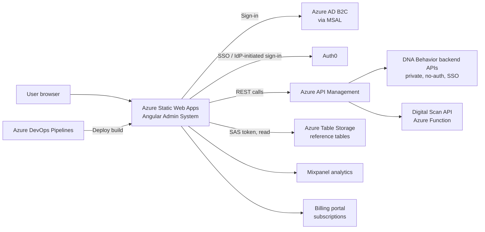

# DNA Behavior Admin System (Frontend): Project Documentation

## 1. Project Overview

The DNA Behavior Admin System is the web application that administrators, advisors and managers use to work with DNA Behavior assessment results. Users sign in, manage accounts, users, roles and subscriptions, and view behavioural insights and reports (coaching, sales, digital scan, team and communication reports), which can be exported to PDF or CSV. It is a single-page Angular application. All business data comes from backend APIs published through Azure API Management. Some reference content (trait descriptions, report access lists, video links) is read directly from Azure Table Storage. The built site is hosted on Azure Static Web Apps and deployed by Azure DevOps pipelines.

## 2. Tech Stack and Packages

| Package | Version | Purpose |
|---|---|---|
| @angular/core (and related @angular/* packages) | ^17.1.0 | Application framework |
| @angular-builders/custom-webpack | ^17.0.0 | Custom build step that injects `.env` values into the app |
| @ngrx/store, @ngrx/effects | ^17.1.0 | Application state management |
| @azure/msal-angular / @azure/msal-browser | ^3.0.11 / ^3.7.1 | Azure AD B2C sign-in (listed under devDependencies but used at runtime) |
| @auth0/auth0-angular | ^2.2.3 | Auth0 sign-in for SSO / IdP-initiated logins |
| primeng, primeflex, primeicons | ^17.3.3 / ^3.3.1 / ^6.0.1 | UI component library and layout |
| bootstrap, ngx-bootstrap, admin-lte | ^5.3.2 / ^12.0.0 / ^3.2.0 | Styling and admin layout |
| chart.js, ng2-charts, highcharts | ^4.4.1 / ^5.0.4 / ^11.3.0 | Charts and graphs in reports |
| jspdf, pdfmake, html2canvas, html-to-image | ^2.5.1 / ^0.2.9 / ^1.4.1 / ^1.11.13 | PDF and image export of reports |
| json-to-csv-export | ^2.1.1 | CSV export |
| axios | ^1.6.5 | HTTP client (used alongside Angular HttpClient) |
| mixpanel-browser | ^2.48.1 | Usage analytics |
| shepherd.js, angular-shepherd | ^14.5.1 / ^19.0.2 | Guided product tours |
| ngx-markdown, marked | ^18.1.0 / ^14.0.0 | Rendering markdown content |
| rxjs | ~7.8.1 | Reactive programming |
| typescript | ~5.3.3 | Language |

Build and runtime: Node.js 20.x in CI (README says 18.x or later locally). Tests use Karma and Jasmine. Code quality is checked with ESLint and SonarQube.

Full list of dependencies: [package.json](../package.json).

## 3. Environment Configuration

**How settings are loaded:** Angular picks one environment file per build configuration (see `fileReplacements` in [angular.json](../angular.json)):

| Build configuration | Environment file | Where values come from |
|---|---|---|
| `dev` | `src/environments/environment.dev.ts` | Hard-coded in the file |
| `qa` | `src/environments/environment.qa.ts` | `.env` file in the repo root, injected at build time by [custom-webpack.config.js](../custom-webpack.config.js) |
| `sandbox` | `src/environments/environment.sandbox.ts` | Hard-coded in the file |
| `production` | `src/environments/environment.prod.ts` | Hard-coded in the file |
| local (`ng serve`) | `src/environments/environment.ts` | `.env` file (same as QA) |

All values are built into the JavaScript files sent to the browser, so every one of them can be seen by end users. [.env.example](../.env.example) lists the variables.

| Variable Name | Description | Required |
|---|---|---|
| `B2C_1_SIGNIN` | Azure AD B2C sign-in policy URL | Yes |
| `CLIENT_ID` | Azure AD B2C application (client) ID | Yes |
| `SCOPE` | Azure AD B2C API scope | Yes |
| `AUTHORITY_DOMAIN` | Azure AD B2C authority domain | Yes |
| `AUTH0_CLIENT_ID` | Auth0 application client ID | Yes |
| `AUTH0_DOMAIN` | Auth0 tenant domain | Yes |
| `AUDIENCE` | Auth0 API audience | Yes |
| `BASE_URL` | Main private API base URL (API Management) | Yes |
| `NO_AUTH_URL` | API base URL for calls that need no sign-in | Yes |
| `IDP_INITIATED_API_URL` | API base URL for SSO / IdP-initiated sign-in | Yes |
| `DIGITAL_SCAN_API_URL` | Digital Scan API (Azure Function) URL | Yes |
| `HOSTING_URL` | Public URL of this Admin System | Yes |
| `DISCOVERY_APP_URL` | URL of the DNA Discovery (assessment) app | Yes |
| `SUBSCRIPTION_URL` | Billing portal URL | Yes |
| `AZURE_TABLE_URL` | Azure Table Storage endpoint | Yes |
| `AZURE_SHARED_ACCESS_KEY` | SAS token for Azure Table Storage (secret) | Yes |
| `MIXPANEL_TOKEN` | Mixpanel project token | Yes |
| `TIMEOUT` | API request timeout in milliseconds (30000 in hard-coded files) | Yes |
| `PRODUCTION` | `true` enables production mode (read by `environment.ts` / `environment.qa.ts`) | No (defaults to false) |

**Where secrets are stored:** Today the SAS tokens and other settings sit directly in source control, in `.env`, `.env.dev` and the `environment.*.ts` files. No Key Vault or pipeline variables are used for app settings. The only pipeline secrets are the Static Web Apps deployment tokens (`Dev_Token`, `QA_Token`, `Sandbox_Token`, `Production_Token`), which are stored as Azure DevOps pipeline variables. `.env.dev` is not read by the build (the webpack config only loads `.env`).

## 4. Azure Storage and Expiry

| Name | Purpose | Environment |
|---|---|---|
| Storage account `sauatenvironment` (Table service) | Reference and access tables (list below) | Dev, QA, local |
| Storage account `saproddnabehavior` (Table service) | Same tables | Sandbox, Production |
| Tables: `CustomReportsAccessTable`, `CoachingReportAccessTable`, `DigitalScanAccess` | Which accounts can see sales, coaching and digital scan reports | All |
| Tables: `TraitsDescriptionTable`, `CoachingReportWordsTable`, `CoachingReportTraitsTableV1`, `FactorRelationshipTable`, `UniqueStyleDescriptionTable` | Report text and trait content | All |
| Tables: `BDNAUniqueStyleVideoLinks`, `FDNAUniqueStyleVideoLinks` | Video links shown in reports | All |

Note: Sandbox points at the **production** storage account.

**How access works:** The browser calls the Table Storage REST endpoint directly ([user-requests.ts](../src/app/service/requests/user-requests.ts)). It adds the **SAS token** from `AZURE_SHARED_ACCESS_KEY` to each table URL. No connection string or managed identity is used by the frontend. The app only reads from these tables, but the current tokens also allow write and delete.

| Item | Type | Expiry Date | Renewal Steps |
|---|---|---|---|
| Table SAS: `saproddnabehavior` (Sandbox and Production) | SAS token | **2026-10-30 14:49 UTC** | 1. In the Azure Portal, open the storage account, then Shared access signature. 2. Generate a new account SAS (Table service, read-only is enough). 3. Update `azureSharedAccessKey` in `environment.prod.ts` and `environment.sandbox.ts`. 4. Merge to `main` to redeploy. |
| Table SAS: `sauatenvironment` (Dev, QA, local) | SAS token | 2027-01-08 16:14 UTC | Same steps. Update `environment.dev.ts`, `.env` and `.env.dev`, then merge to `development`. |
| Static Web Apps deployment tokens (`Dev_Token`, `QA_Token`, `Sandbox_Token`, `Production_Token`) | Deployment key | TODO: confirm | Reset the token in Azure Portal (Static Web App, Manage deployment token), then update the matching Azure DevOps pipeline variable. |
| Azure AD B2C app registrations (Dev, Sandbox, Prod) | Certificate / client secret | TODO: confirm (frontend uses public client IDs only) | TODO: confirm |
| Custom domain TLS certificates (`*.dnabehavior.com`) | Certificate | TODO: confirm (likely managed by Static Web Apps) | TODO: confirm |

## 5. Environments and Deployment

| Environment | URL | Branch | Deployment Trigger |
|---|---|---|---|
| Dev | https://devadmin.dnabehavior.com/ | `development` | Automatic on push ([dev-qa-admin-system-azure-pipelines.yml](../dev-qa-admin-system-azure-pipelines.yml)) |
| QA | https://qaadmin.dnabehavior.com/ | `development` | Automatic, runs after the Dev deployment succeeds (same pipeline) |
| Sandbox | https://sandboxadmin.dnabehavior.com/ | `main` | Automatic on push ([azure-pipelines.yml](../azure-pipelines.yml)) |
| Production | https://app.dnabehavior.com/ | `main` | Automatic, runs after Sandbox in the same pipeline. Approval gate on `ProductionAdminSystem`: TODO: confirm |

**Deployment steps**

1. Open a pull request into `development` and merge it once reviewed.
2. The Dev/QA pipeline builds with `ng build --configuration=dev`, deploys to Dev Static Web App, then builds `--configuration=qa` and deploys to QA.
3. Test on Dev and QA.
4. Open a pull request from `development` into `main` and merge it.
5. The main pipeline builds `--configuration=sandbox`, deploys to Sandbox, then builds `--configuration=production` and deploys to Production.
6. Check that the Production site loads and that sign-in works.

**Rollback steps**

1. Revert the faulty commit on the branch (`git revert <commit>`) and push. The pipeline will redeploy the previous code.
2. For a faster fix, re-run an earlier successful pipeline run in Azure DevOps to redeploy that build (TODO: confirm this is the agreed process).

**Known Limitations**

- SAS tokens and other settings are committed to the repository and shipped to the browser. Anyone using the site can read them. Consider moving table reads behind the API, or using read-only, short-lived tokens.
- The Production/Sandbox SAS token expires on **2026-10-30**. Report access checks and report text will fail after that date unless the token is renewed.
- The Dev build step runs `cd dist/dna-behavior` before `npm install`. That folder does not exist on a fresh build agent. TODO: confirm the Dev build is working.
- No infrastructure-as-code (Bicep, ARM or Terraform) is in this repository, so Azure resources are managed outside it.
